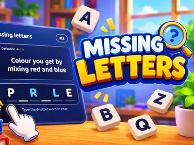
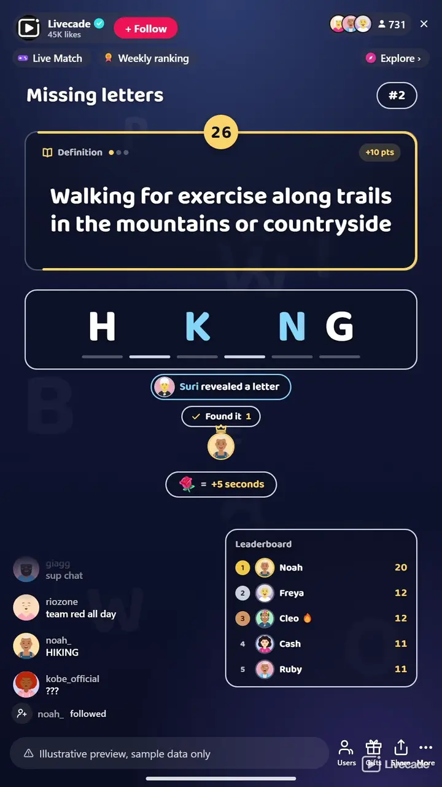

# Missing Letters - Interactive TikTok Live Game

> A clue, a word with gaps, and the whole chat racing to fill it.

A chat word quiz. A clue goes up with its answer's letters missing, viewers type the word in chat, and letters fill in as the clock runs down. Everyone who finds it scores, the fastest most. Rounds run on their own, so you can leave it on and talk over it.

**[Play Missing Letters on Livecade](https://livecade.io/games/missing-letters/?utm_source=github&utm_medium=readme&utm_campaign=missing-letters)** - runs as a single browser source in OBS, Streamlabs, or TikTok LIVE Studio. Nothing for viewers to install.

## How viewers play

Viewers take part with the actions TikTok already gives them: **comments**, **gifts**, **likes**. Every action below is rebindable, so you decide which interaction drives which effect.

| Action | What it does |
| --- | --- |
| **Reveal a Letter** | Shows one more letter, always leaving one hidden |
| **+5 Seconds** | Adds five seconds to the question; every Rose counts, up to a minute per question, and the rest carry to the next |
| **Skip the Question** | Throws out the clue on screen and deals the next one |

## How it works

### Type the missing word

A clue appears with the answer's first and last letters showing. Viewers type the word in chat, and their pictures pop in as they find it.

### Letters fill in

A letter appears at half time and another at three quarters, and likes can reveal more. One letter always stays hidden until the answer.

### Fast finders score most

Everyone who finds the word scores, with a bonus for finding it fast and a multiplier for every word in a row, up to double.

## About the game

Missing Letters puts a clue on screen, a definition, a proverb with one word gone, a synonym or a general knowledge question, with the answer underneath and most of its letters missing. Your chat types the word. Letters fill in as the clock runs down, and likes from the room reveal more, but one always stays hidden until the answer lands.

### Everyone can score

Every viewer who finds the word scores, and the fastest score the most. Finding words in a row multiplies the points, up to double. Viewers can type the word without accents, and a short message ending with the word counts too, so "it's moon" works as well as "moon".

### Your clues, your stage

The bank ships with over 66,000 clues across thirteen languages, written in each language rather than translated, so the proverbs are the ones your viewers grew up with. Edit any clue, hide the ones that do not suit your room, or write your own. Pick the question types and the difficulty, set five colors, swap any of the twelve sound effects, and let the game read each clue and its answer aloud in your stream voice.

## What it looks like on stream

[Watch Missing Letters gameplay](https://cdn.livecade.io/games/missing-letters.mp4)

## What you can configure

- **Language** - Thirteen languages for the clues and the on-screen text
- **Question types** - Definitions, synonyms and opposites, expressions, proverbs and general knowledge
- **Difficulty** - Easy, medium, hard or mixed clues
- **Your questions** - Edit, hide or add your own clues in any language
- **Timing** - Seconds per question and seconds on the answer
- **Match** - Play all stream, or end after a number of questions or at a target score, with a podium for the top three
- **Starting letters** - First and last, first only, or none
- **Letter hints** - Letters that fill in as time runs out, and the most that can be revealed
- **Leaderboard** - Keep up to 20 top players on screen in a column clear of the chat
- **Read aloud** - The clue as it appears, and the answer with the first finder, in your stream voice
- **Your sounds** - Swap any of the twelve sound effects for your own audio
- **Appearance** - Colors for the panels, their borders, the hint letters, the accent and the text
- **Background** - Transparent, a solid color, or your own image, with drifting letters on or off
- **Who can play** - Everyone, followers only, or your fans club only. Applies to comments and gifts

## Languages

English, Spanish, Portuguese, French, German, Italian, Indonesian, Arabic, Turkish, Russian, Hindi, Romanian, Filipino

## FAQ

<strong>How do viewers play Missing Letters?</strong>

A clue appears with a word underneath that has most of its letters missing. Viewers type the word in your TikTok Live chat. Everyone who finds it scores, and the fastest score the most.

<strong>Do viewers need to send gifts to play?</strong>

No. Playing is free and comment-driven. Likes can reveal a letter, and gifts can add time or skip the clue.

<strong>Which languages does it support?</strong>

Thirteen: English, Spanish, Portuguese, French, German, Italian, Indonesian, Arabic, Turkish, Russian, Hindi, Romanian and Filipino. Each language has its own clues and proverbs, written in that language.

<strong>How is Missing Letters different from Find the Word?</strong>

Find the Word hides a word with no clue. Missing Letters gives a clue, a definition or a proverb to complete, so viewers solve it by knowing the answer, with the letters as hints.

<strong>Can I use my own clues?</strong>

Yes. The bank holds over 66,000 clues across thirteen languages, and you can edit any of them, hide the ones that do not suit your room, or write your own.

<strong>How do I add Missing Letters to my TikTok Live?</strong>

Add one browser source URL to OBS or your streaming software and go live. There is no plugin to install and nothing for your viewers to download.

## Setup

1. [Create a Livecade account](https://app.livecade.io/register?utm_source=github&utm_medium=cta&utm_campaign=missing-letters)
2. Copy your overlay browser source URL
3. Paste it into OBS, Streamlabs, or TikTok LIVE Studio
4. Pick Missing Letters, set your triggers, and go live

Runs in the browser, so it works on Windows and macOS with nothing to download. [See all TikTok Live games](https://livecade.io/tiktok-live-games/?utm_source=github&utm_medium=readme&utm_campaign=missing-letters).

---

_This repository documents Missing Letters, a hosted interactive game by [Livecade](https://livecade.io/?utm_source=github&utm_medium=footer&utm_campaign=missing-letters). The game runs on Livecade's platform, so there is no source to install here._
